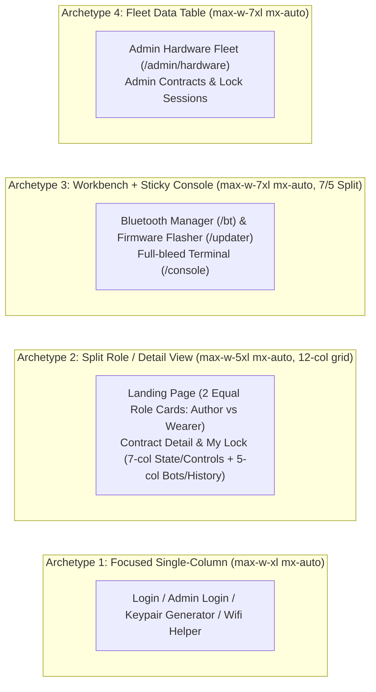

# Tartarus Visual Design System & Styleguide (`spartan.ng`)

> [!IMPORTANT]
> **Purpose of this Document**: This styleguide is the canonical source of truth for the visual language, accessibility standards, layout architecture, and `spartan.ng` (`@spartan-ng/brain` + `@spartan-ng/helm`) component patterns of **Tartarus**. Downstream engineers and AI models MUST adhere to these tokens and patterns when migrating from `@ng-bootstrap/ng-bootstrap` + Bootswatch (`spacelab`) or building new features.

---

## 1. Design Philosophy: "Tactile Cryptographic Precision"

Tartarus sits at the intersection of **intimate, high-trust personal agreements** (digital contracts, keyholding, physical lock control) and **low-level cryptographic hardware engineering** (ECDSA P-256 signatures, OPTIGA™ Trust M attestation, ESP32-S3 eFuses, WebBLE, and WebSerial).

Historically, the UI relied on Bootswatch *Spacelab* (`bootstrap.min.css`), resulting in a dated 2014 glossy-gradient aesthetic, inconsistent layout widths (`col-lg-4` left-aligned columns on desktop), jarring full-card status fills (`card bg-success text-white`), and ad-hoc global margin hacks (`.btn { margin: 0.25em }`, `.row { margin-top: 1em }`).

Our new visual language—**Tactile Cryptographic Precision**—is built on four pillars:

1. **Calm Authority over Visual Noise**: Never flood entire cards with saturated primary/success/danger backgrounds. Surfaces remain neutral (`bg-card`); semantic color is reserved strictly for status badges (`hlmBadge`), subtle left-border accents, icon tints, and destructive action buttons.
2. **Cryptographic Legibility**: Keys, tokens, hashes, serial counters, CoprUIDs, and FlatBuffers payloads are first-class citizens. They are always rendered in a high-legibility monospace font with tabular numerals, clear truncation/copy affordances, and distinct code-surface styling.
3. **Physical State Clarity**: A user or keyholder must never second-guess whether a hardware lock is **Locked**, **Unlocked**, **Emergency Unlocked**, or **Stale/Offline**, nor whether a hardware operation (eFuse burn, contract release, session revoke) is **irreversible**.
4. **Zero-Compromise Accessibility (WCAG 2.2 AA)**: Every interactive primitive uses `@spartan-ng/brain` (built on Angular CDK) for WAI-ARIA compliance, keyboard navigation, focus trapping, and screen-reader announcements.

---

## 2. Color System & Semantic Tokens (HSL CSS Variables + `color-scheme`)

Tartarus uses Tailwind CSS + `spartan.ng` CSS custom properties in [styles.scss](file:///Users/chris/Development/qrdisplay/tartarus/src/styles.scss). Instead of Bootswatch's glossy blue gradients, we use a **Slate / Zinc neutral foundation** paired with a **Deep Indigo-Violet primary accent** (signifying authority and cryptographic trust) and high-contrast semantic tokens for hardware states.

### 2.1 Core Theme Tokens

Define these in `src/styles.scss` under `:root` (Light Mode), `@media (prefers-color-scheme: dark)` / `.dark` (Dark Mode), and subtree overrides for terminal consoles (`color-scheme: dark`) and QR quiet zones (`color-scheme: only light`):

```scss
:root {
  color-scheme: light dark;

  /* Base Surfaces */
  --background: 220 20% 98%;       /* Cool Crisp Alabaster (#F8FAFC) */
  --foreground: 224 71% 4%;        /* Deep Obsidian Ink (#030712) */

  /* Elevated Surfaces (Cards, Panels) */
  --card: 0 0% 100%;               /* Pure White (#FFFFFF) */
  --card-foreground: 224 71% 4%;

  /* Popovers, Dropdowns, Dialogs, Tooltips */
  --popover: 0 0% 100%;
  --popover-foreground: 224 71% 4%;

  /* Primary Brand: Cryptographic Indigo */
  --primary: 243 75% 59%;          /* Indigo 600 (#4F46E5) */
  --primary-foreground: 210 40% 98%;

  /* Secondary / Neutral Controls */
  --secondary: 220 14% 93%;        /* Slate 100/200 */
  --secondary-foreground: 220 39% 11%;

  /* Muted Surfaces & De-emphasized Metadata */
  --muted: 220 14% 95%;
  --muted-foreground: 220 9% 42%;  /* ≥ 4.6:1 contrast on --background & --card */

  /* Interactive Hover / Selection Accent */
  --accent: 243 75% 96%;
  --accent-foreground: 243 75% 40%;

  /* Destructive / Danger (Abort, Delete, Revoke, eFuse Warning) */
  --destructive: 0 84% 50%;        /* Crimson Red 600 (#DC2626) */
  --destructive-foreground: 210 40% 98%;

  /* Structural Hairlines & Focus Rings (≥ 3:1 non-text contrast for inputs) */
  --border: 220 13% 86%;           /* Crisp 1px structural border */
  --input: 220 13% 72%;            /* Darker input border for 3:1 non-text contrast */
  --ring: 243 75% 59%;             /* High-visibility focus ring */

  /* Domain-Specific Semantic Status Tokens */
  --status-locked: 346 84% 46%;          /* Rose-Crimson: Physically Locked */
  --status-locked-bg: 346 84% 96%;
  --status-unlocked: 158 64% 32%;        /* Emerald: Physically Unlocked / Verified */
  --status-unlocked-bg: 158 64% 95%;
  --status-warning: 32 95% 38%;          /* Amber: Stale / Soft Provisioned / Pending */
  --status-warning-bg: 38 96% 94%;
  --status-emergency: 0 90% 45%;         /* High-alert Red: Emergency Unlocked */
  --status-emergency-bg: 0 93% 95%;

  /* Dedicated Terminal Surface (Always Dark for Serial/BLE Logs) */
  --terminal-bg: 222 47% 7%;             /* #090D16 */
  --terminal-fg: 210 40% 92%;
  --terminal-border: 217 33% 17%;

  /* Geometry Token */
  --radius: 0.5rem;                      /* 8px base radius */
}

.dark {
  color-scheme: dark;
  --background: 224 71% 4%;        /* Obsidian (#030712) */
  --foreground: 213 31% 91%;
  --card: 222 47% 7%;              /* Elevated Slate (#090D16) */
  --card-foreground: 213 31% 91%;
  --popover: 222 47% 9%;
  --popover-foreground: 213 31% 91%;
  --primary: 239 84% 67%;          /* Indigo 400 (#6366F1) */
  --primary-foreground: 224 71% 4%;
  --secondary: 217 33% 15%;
  --secondary-foreground: 210 40% 98%;
  --muted: 217 33% 13%;
  --muted-foreground: 215 20% 68%;
  --accent: 217 33% 17%;
  --accent-foreground: 210 40% 98%;
  --destructive: 0 72% 55%;
  --destructive-foreground: 210 40% 98%;
  --border: 217 33% 18%;
  --input: 217 33% 32%;
  --ring: 239 84% 67%;
}
```

### 2.2 Color Usage Rules & Anti-Patterns

| Element | Old Bootstrap Pattern (DO NOT USE) | New `spartan.ng` Pattern (USE THIS) |
| :--- | :--- | :--- |
| **Contract / Command Cards** | `<div class="card text-white bg-success">` or `bg-primary` | `<section hlmCard>` (neutral background) with `<span hlmBadge variant="...">` in the header and an optional `border-l-4` status stripe. |
| **Card Headers** | `<div class="card-header bg-dark text-white">` on every card | `<div hlmCardHeader class="border-b border-border/60 bg-muted/30">` — reserve dark surfaces strictly for actual terminal consoles (`--terminal-bg`). |
| **Lock State Icons** | Unstyled black `<svg fill="#000">` that vanishes in dark mode | `@ng-icons/lucide` (`lucideLock`, `lucideLockOpen`, `lucideShieldAlert`) using `currentColor` inside a semantic pill container. |
| **QR Code Canvases** | Raw `<canvas>` directly on background | Always frame QR canvases inside `.qr-quiet-zone` (`color-scheme: only light; background: #fff; color: #000; padding: 1rem; border-radius: 0.5rem`) even when Dark Mode is active, because optical QR scanners require a white quiet zone. |

---

## 3. Typography & Scannable Hierarchy

Tartarus displays two fundamentally different kinds of text: **human prose/instructions** (onboarding steps, contract terms, safety warnings) and **machine artifacts** (PEM keys, Base64 payloads, SHA-256 digests, BLE PINs, CoprUIDs, serial logs).

### 3.1 Font Stack

1. **UI & Prose (`--font-sans`)**: `'Inter'`, `'Plus Jakarta Sans'`, or system geometric sans (`system-ui, -apple-system, sans-serif`).
   - Apply `font-feature-settings: "cv02", "cv03", "cv04", "cv11"` for disambiguated characters.
2. **Cryptographic & Hardware Data (`--font-mono`)**: `'JetBrains Mono'`, `'Geist Mono'`, or `'SFMono-Regular', Consolas, monospace`.
   - **Rule**: Every token, contract name/ID, serial number, counter, hardware UID, URI, BLE PIN input, and terminal log MUST use `font-mono tabular-nums` so columns and hex strings align vertically and `0`/`O`, `1`/`l`/`I` are unmistakable.

### 3.2 Type Scale & Hierarchy

Replace arbitrary heading jumps (`<h1>` -> `<h3>` "What is this for?" in [lock-session-detail.component.html](file:///Users/chris/Development/qrdisplay/tartarus/src/app/lock-session-detail/lock-session-detail.component.html#L5-L6)) with a strict semantic hierarchy:

| Role | Tailwind / `spartan.ng` Classes | Usage in Tartarus |
| :--- | :--- | :--- |
| **Page Title (`h1`)** | `text-2xl font-bold tracking-tight text-foreground` | Top of every route view (e.g., *Hardware Fleet & Provisioning*, *Bluetooth Manager*). |
| **Page Subtitle / Lead** | `text-sm text-muted-foreground mt-1` | Replaces the repetitive `<h3>What is this for?</h3><p>...</p>` pattern across all pages! |
| **Section / Card Title (`h2`, `h3`)** | `text-base font-semibold tracking-tight leading-none` | Inside `hlmCardTitle` (e.g., *1. Device Connection*, *Contract Terms*). |
| **Field Label** | `hlmLabel` (`text-sm font-medium leading-none`) | Paired with inputs and switches; never use bare `<label>` without spacing. |
| **Micro-Label / Overline** | `text-xs font-semibold uppercase tracking-wider text-muted-foreground` | Metric card headers (*TOTAL PROVISIONED*), table headers, and key-value metadata labels. |
| **Code / Crypto Token** | `font-mono text-xs bg-muted px-1.5 py-0.5 rounded border border-border/60 select-all` | Inline session tokens, CoprUIDs, firmware offsets (`0x10000`). |
| **BLE 6-Digit PIN Input** | `font-mono text-3xl font-bold tracking-[0.4em] text-center tabular-nums` | [bt.component.html](file:///Users/chris/Development/qrdisplay/tartarus/src/app/bt/bt.component.html#L141-L152) PIN entry or `brn-input-otp`. |

---

## 4. Geometry, Radii, Elevation & Spacing

### 4.1 The Nested Radius Formula
Bootswatch *Spacelab* mixes pill buttons, sharp tables, and `0.5rem` cards haphazardly. Under our `spartan.ng` system, radii follow a **concentric nesting rule** anchored at `--radius: 0.5rem` (`8px`):

- **Modals, Drawers & Top-Level Cards (`hlmCard`, `hlmDialogContent`)**: `rounded-xl` (`12px` / `calc(var(--radius) + 4px)`)
- **Buttons, Inputs, Selects, Alerts & Inner Sub-cards (`hlmBtn`, `hlmInput`, `hlmAlert`)**: `rounded-md` (`6px` / `calc(var(--radius) - 2px)`)
- **Data Badges & Crypto Tags (`hlmBadge`)**: `rounded-md` (`6px`) for technical/hex tags (`#0`, `0x10000`, `HARD`), or `rounded-full` for live status pills (`● Connected`, `🔒 Locked`).
- **QR Code Quiet Zone Frame**: `rounded-lg` (`8px`) outer border with `p-4` internal padding.

### 4.2 Elevation & Borders
- **Crisp Borders over Muddy Shadows**: Replace Bootstrap's heavy `.shadow` and `.shadow-lg` with `border border-border shadow-2xs` on cards, elevating to `shadow-lg` only on floating overlays (`hlmDialogContent`, `hlmDropdownMenu`, `hlmSheetContent`).
- **Ban Global Margin Hacks**: Do not apply global `.btn { margin: 0.25em }` or `.row { margin-top: 1em }` to `spartan.ng` components. Spacing must be owned by parent flex/grid containers using Tailwind's `gap-2`, `gap-4`, `space-y-4`, and `space-y-6`.

### 4.3 Layout Archetypes (Fixing the `col-lg-4` Anti-Pattern)
Currently, pages like [landing-page.component.html](file:///Users/chris/Development/qrdisplay/tartarus/src/app/landing-page/landing-page.component.html), [my-lock.component.html](file:///Users/chris/Development/qrdisplay/tartarus/src/app/my-lock/my-lock.component.html), [new-keypair.component.html](file:///Users/chris/Development/qrdisplay/tartarus/src/app/new-keypair/new-keypair.component.html), and [coordinator-configuration.component.html](file:///Users/chris/Development/qrdisplay/tartarus/src/app/coordinator-configuration/coordinator-configuration.component.html) wrap content in `<div class="row"><div class="col-lg-4">`, leaving **66% of desktop screens completely blank** on the right!

Every route in Tartarus must use one of **four canonical layout archetypes**:



---

## 5. Accessibility (a11y) Mandate

Because Tartarus controls physical locking hardware and cryptographic keys, accessibility is a **safety requirement**:

1. **Modal & Drawer Focus Management**:
   - The custom `<div class="modal d-block">` overlays in [provisioning-ingest-modal.component.html](file:///Users/chris/Development/qrdisplay/tartarus/src/app/admin/hardware/provisioning-ingest-modal.component.html#L1) and [hardware-unit-detail-modal.component.html](file:///Users/chris/Development/qrdisplay/tartarus/src/app/admin/hardware/hardware-unit-detail-modal.component.html#L1) lack focus trapping, `aria-modal="true"`, `Escape` key dismissal, and background scroll locking.
   - **Rule**: All modals and side drawers MUST use `BrnDialog` / `HlmDialog` or `HlmSheet` (which delegate to Angular CDK `Overlay` and `FocusTrap`).
2. **Interactive Badges & Copy Triggers**:
   - In [bot-selector.component.html](file:///Users/chris/Development/qrdisplay/tartarus/src/app/bot-selector/bot-selector.component.html#L101-L110) and [contract-detail.component.html](file:///Users/chris/Development/qrdisplay/tartarus/src/app/contract-detail/contract-detail.component.html#L35-L44), public key copy triggers are `<span class="badge ... cursor-pointer" (click)="copyKey(...)">` with `ngbTooltip`. A `<span>` is not keyboard-focusable (`Tab` skips it) and cannot be activated with `Enter`/`Space`.
   - **Rule**: Every clickable copy badge or table row action MUST be a native `<button type="button">` styled with `hlmBadge` or `hlmBtn variant="ghost" size="xs"`, paired with `brnTooltipTrigger` and an `aria-live="polite"` announcement when copied.
3. **Live Hardware & Terminal Regions**:
   - Connection badges (`Connected`, `Flashing: 45%`, `Locked Out`) in `/bt`, `/updater`, and `/console` must include `aria-live="polite"` so screen readers announce state transitions without moving focus.
   - Emergency Unlock banners (`contract.lockState?.emergencyUnlocked`) must use `role="alert"` and `hlmAlert variant="destructive"`.
4. **Never Rely on Color or Emoji Alone**:
   - Every status indicator must pair **Color + Icon (`lucide-*`) + Explicit Text Label** (e.g., `[🔒 Locked]`, `[🔓 Unlocked]`, `[🛡️ HARD]`, `[🧪 SOFT]`).
   - All decorative emojis or SVGs must carry `aria-hidden="true"`.
5. **Touch Target Minimums**:
   - Mobile users frequently operate `/my-lock`, `/login`, and `/lock-sessions` on phones. Primary action buttons must meet at least **44×44px** (`hlmBtn size="lg"` on mobile) and table action buttons at least **36×36px**.

---

## 6. Component Mapping: `bootstrap-ng` to `spartan.ng`

### 6.1 Global Navigation & App Shell ([app.component.html](file:///Users/chris/Development/qrdisplay/tartarus/src/app/app.component.html))
- **Problem**: Everything is stuffed into a single right-aligned "Menu" `ngbDropdown` where `<button ngbDropdownItem><a routerLink="...">` nests an `<a>` inside a `<button>` (invalid HTML that breaks keyboard navigation and middle-click open-in-new-tab!).
- **`spartan.ng` Solution**:
  - Replace with a clean top header bar (`border-b bg-background/95 backdrop-blur supports-[backdrop-filter]:bg-background/60 sticky top-0 z-40`).
  - Surface primary links directly on desktop (`Home`, `Lock Sessions`, `My Lock`, and a `Hardware Tools` `BrnMenuTrigger` / `HlmMenu` dropdown for BLE, USB Flasher, Serial Console, Config).
  - Fix the invalid `<button><a>` nesting by applying `hlmMenuItem` directly to `<a routerLink="...">`!
  - Show active session status pills (`Keyholder Active`, `Wearer Session Active`) in the top bar with a quick-logout menu item.

### 6.2 Status Cards: Contracts, Lock Sessions & Commands
- **Files**: [contract-card.component.html](file:///Users/chris/Development/qrdisplay/tartarus/src/app/contract-card/contract-card.component.html), [lock-session-card.component.html](file:///Users/chris/Development/qrdisplay/tartarus/src/app/lock-session-card/lock-session-card.component.html), [command-card.component.html](file:///Users/chris/Development/qrdisplay/tartarus/src/app/command-card/command-card.component.html), [event-card.component.html](file:///Users/chris/Development/qrdisplay/tartarus/src/app/event-card/event-card.component.html)
- **Problem**: `contract-card` and `command-card` duplicate the entire card markup 3–6 times inside a `@switch` block just to change `bg-success` / `bg-primary` / `bg-light`, and constrained to `style="max-width: 20rem;"`. Blue links inside `.bg-primary.text-white` cards have near-zero contrast!
- **`spartan.ng` Solution**:
  - Use a **single** `<section hlmCard class="flex flex-col justify-between transition-colors hover:border-primary/40">` template per component.
  - Represent state via `<span hlmBadge [variant]="getStateVariant(contract.state)">` in `hlmCardHeader`.
  - Add a subtle 4px left accent border (`border-l-4 border-l-emerald-500` for Active/Confirmed, `border-l-indigo-500` for Pending/Created, `border-l-slate-300` for Released).
  - Replace bare `<a>Details</a>` with a full-card clickable area or `<a hlmBtn variant="outline" size="sm">View Contract →</a>` in `hlmCardFooter`.

### 6.3 Dialogs, Confirmations & Detail Sheets
- **Files**:
  - Delete confirmation in [lock-sessions.component.html](file:///Users/chris/Development/qrdisplay/tartarus/src/app/lock-sessions/lock-sessions.component.html#L22-L41) (`NgbModal` -> `HlmAlertDialog`)
  - Provisioning ingest modal in [provisioning-ingest-modal.component.html](file:///Users/chris/Development/qrdisplay/tartarus/src/app/admin/hardware/provisioning-ingest-modal.component.html) (Custom `.modal.d-block` -> `HlmDialog`)
  - Hardware unit detail modal in [hardware-unit-detail-modal.component.html](file:///Users/chris/Development/qrdisplay/tartarus/src/app/admin/hardware/hardware-unit-detail-modal.component.html) (Custom `.modal.d-block` -> **`HlmSheet` side drawer** or `HlmDialog`)
- **`spartan.ng` Solution**:
  - Use `HlmAlertDialog` (`brnAlertDialog`) for destructive confirmations (deleting a lock session, aborting/resetting a contract, clearing the BLE flash event queue, revoking a hardware unit).
  - Convert `HardwareUnitDetailModalComponent` into a right-hand **`HlmSheet` (`side="right" class="w-full sm:max-w-2xl overflow-y-auto"`)** so admins inspecting hardware units in `/admin/hardware` can slide open a unit's attestation logs and eFuse posture while keeping the fleet context.

### 6.4 Forms, Toggles, Radio Cards & File Dropzones
- **Files**: [new-full-contract.component.html](file:///Users/chris/Development/qrdisplay/tartarus/src/app/new-full-contract/new-full-contract.component.html), [login.component.html](file:///Users/chris/Development/qrdisplay/tartarus/src/app/login/login.component.html), [updater.component.html](file:///Users/chris/Development/qrdisplay/tartarus/src/app/updater/updater.component.html), [bt.component.html](file:///Users/chris/Development/qrdisplay/tartarus/src/app/bt/bt.component.html)
- **`spartan.ng` Solution**:
  - **Switches**: Replace `.form-check.form-switch` with `<hlm-switch>` (`brn-switch`) paired with `hlmLabel` and a helper description subtext (e.g., explaining what *Temporary Unlock Allowed* or *Emergency Unlock Allowed* means in a contract).
  - **Firmware Track Selection**: In [updater.component.html](file:///Users/chris/Development/qrdisplay/tartarus/src/app/updater/updater.component.html#L188-L277), replace nested radio buttons + button-group toggles with `HlmRadioGroup` styled as selectable choice cards and `HlmTabs` (`brnTabs`) to cleanly switch between *Server Manifest Releases* and *Local Custom `.bin` Upload*.
  - **QR Key Dropzone**: In [login.component.html](file:///Users/chris/Development/qrdisplay/tartarus/src/app/login/login.component.html#L8) and [key-helper.component.html](file:///Users/chris/Development/qrdisplay/tartarus/src/app/key-helper/key-helper.component.html#L10), replace the raw unstyled `<input type="file">` with a tactile drag-and-drop / tap-to-upload card (`border-2 border-dashed border-border hover:border-primary/60 rounded-xl p-8 text-center transition-colors`).

### 6.5 Toasts & Live Notifications
- **Files**: [toast-container.component.ts](file:///Users/chris/Development/qrdisplay/tartarus/src/app/toast-container/toast-container.component.ts), [toast.service.ts](file:///Users/chris/Development/qrdisplay/tartarus/src/app/toast.service.ts)
- **`spartan.ng` Solution**:
  - Replace `NgbToast` and `ToastContainerComponent` with **`HlmToaster`** (`ngx-sonner`, the official `spartan.ng` toast primitive).
  - Keep `ToastService` as an adapter facade (`showInfo`, `showSuccess`, `showError`) calling `toast()`, `toast.success()`, and `toast.error()` from `ngx-sonner` so existing service callers require zero changes.
