# Building the Lock

## Bill of Materials

In order to build the lock you will need:

### Mandatory parts

* [Adafruit ESP32-S3 Reverse TFT Feather - 4MB Flash, 2MB PSRAM, STEMMA QT](https://www.adafruit.com/product/5691). Homebrew versions are totally welcome and don't limit your features.
* [STEMMA QT / Qwiic JST SH 4-Pin Cable - 50mm Long](https://www.adafruit.com/product/4399)
* [Micro servo - TowerPro SG92R](https://www.adafruit.com/product/169) - You can also use any generic SG90/SG92 form factor servo.
* [7x Socket Head Cap Screw: M2-0.4 Thread Size, 8 mm Lg, Std, Black Oxide, Steel, Class 12.9, 100 PK](https://www.grainger.com/product/6CE33)
* [7x Hex Nut: M2-0.40 Thread, 4 mm Hex Wd, 1.6 mm Hex Ht, Steel, Class 8, Zinc Plated, 100 PK](https://www.grainger.com/product/26KR83)
* Adhesive: 2-part Epoxy is strongly recommended for a robust and tamper-resistant seal. (Hot glue can be used if you want some margin of error during prototyping, but 2-part epoxy is recommended for permanent assembly).

### Hardware Security Module (For Official Builds)

* [Optiga Trust M Breakout](https://www.adafruit.com/product/4351) (available from [Adafruit](https://www.adafruit.com/product/4351) or [DigiKey](https://www.digikey.com/en/products/detail/adafruit-industries-llc/4351/10650641)). Connected via STEMMA QT / Qwiic. Required if you want an "official" build with hardware-backed cryptographic identity and badge on the coordinator. Homebrew builds without this module use the built-in software `SecurityBackend`.

### Legacy / Optional parts

* [Tiny Code Reader from Useful Sensors](https://www.adafruit.com/product/5744) - **Notice**: We now explicitly advise against using the QR code reader, and updated shape files for the build will not include a slot for it. Wi-Fi setup and device management are now handled over Web Serial USB or Bluetooth LE.

### Optional, but good to have

* [3M VHB Tape](https://www.3m.com/3M/en_US/vhb-tapes-us/) (or high-strength double-sided foam mounting tape) — Used to mount the Optiga Trust M breakout board firmly to the inside of the case.
* [Loctite Threadlocker Blue](https://www.loctiteproducts.com/products/central-pdp.html/loctite-threadlocker-blue/SAP_0201OHL029W4.html) - Makes the lock more tamper resistant.
* Tiny cable tie
* [4mm Nut driver](https://www.amazon.com/dp/B0009OIJMI?th=1) - Definitely makes tightening the nuts easier, but far from necessary. Also you probably want a magnetized one, but this is what I have.

### Tools

* Soldering iron
* Technical screwdriver (T6 bit)
* Tiny technical flathead screwdriver or razor blade (used to lift the retaining tabs on the servo connector to swap 3V3 and GND pins)

## 3D Files

You can get the full kit of parts here: [Full kit](static/tartarus_parts.3mf)

I personally use Prusa slicer + the Prusa MINI+ for most builds. I use organic supports, 15% infill, and the 0.20mm SPEED profile.
Feel free to adjust as necessary. I recommend printing with PLA.

## Assembly

### Step 1: Print the parts

* 3D printer
* Several hours

### Step 2: Solder headers to ESP32-S3

* ESP32-S3 + included headers

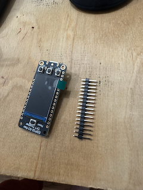

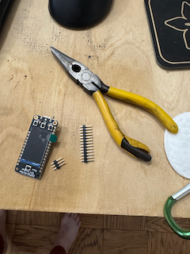

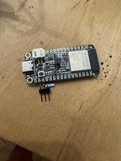

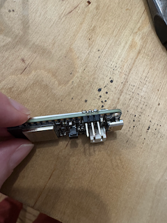``

Use a pair of pliers and break off 3 headers from the full strip that comes with the ESP32-S3.

You'll solder these headers (short-side through top) across 3V, GND, and A0. See picture.
Also check out the [pinout guide](https://learn.adafruit.com/esp32-s3-reverse-tft-feather/pinouts) from Adafruit.

### Step 3: Flash the firmware

> [!TIP]
> **Recommended Method**: Almost everyone should just be using the in-browser **[Web Serial Flasher](https://tartarus.subjugated.club/updater)**. It connects over Web Serial (in Chrome, Edge, or Opera) to automatically flash the latest official signed release, configure partitions, and report status without installing Rust or command-line developer tools.
>
> **Important**: If you are flashing the official signed release, please review the [Signed Firmware & Secure Boot v2 guide](setting_up_the_lock.md#signed-firmware--secure-boot-v2) **before** flashing. Enabling Secure Boot v2 is an irreversible 1-way physical change to the microcontroller eFuses.

#### Manual Flashing via Command Line (Developers)

If you are developing custom firmware or flashing locally from source:

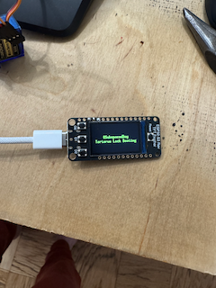`

Hold down D0 and press Reset. Build and flash the firmware with:
```bash
cargo build --release

espflash flash --monitor --partition-table partitions.csv target/xtensa-esp32s3-espidf/release/tartarus-firmware
```
If it looks like it succeeded but says "Waiting for download" you just need to reset it one more time.

You should see the boot screen followed by "Needs configuration."

We do this now because we need the firmware to calibrate the servo.

### Step 4: Assemble servo bracket

* 2x 2mm screws
* 2x hex nuts
* 1x mounting bracket
* 1x SG92 servo (with single-ended horn, and small screw that came with it) 

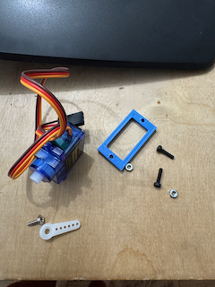`

### Step 5: Wire servo to ESP32-S3 (Repin Servo Connector)

> [!IMPORTANT]
> **No Jumper Wires**: In the newer revision of the hardware, internal clearance is tight and there is not enough space to accommodate female-to-male jumper wires. We do **not** recommend using jumper wires. Instead, repin the servo's 3-pin Molex connector directly so it plugs straight onto the board headers.

The ESP32-S3 board pinout across the 3 soldered headers is `3V`, `GND`, and `A0` (Signal), whereas standard servo wiring is `GND` (brown/black), `3V` (red), and `Signal` (yellow/orange).

To swap the pin assignment directly on the servo connector:
1. Use a tiny technical flathead screwdriver or razor blade to gently lift the small plastic retaining tabs on the servo's Molex housing for the `3V` (red) and `GND` (brown/black) pins.
2. Slide the red and brown/black crimp terminals out of the plastic housing (leave the signal wire untouched).
3. Swap their positions so `3V` is on the outside, matching the ESP32-S3's `3V`, `GND`, `A0` pinout.
4. Slide them back into the housing until the plastic tabs click securely into place.
5. Plug the repinned connector directly onto the 3-pin header on the ESP32-S3.

Connect USB power to the ESP32-S3 and you will probably hear a quick buzz. The servo is now
in the "down" angle position so we can mount the horn.

### Step 6: Mount the horn

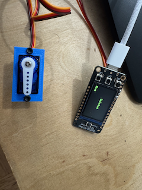`

Mount the horn at 6 as if it were a clock. Connect power back to the ESP32-S3 and make sure the
servo starts at 6. Toggle the lock on the second screen (D2 to change screen and then by pressing D1, the middle button). It should freely rotate
to a 3 o'clock position and back. If it does, use the small-sized screw and mount the horn permanently. Try
not to rotate the horn while tightening.

### Step 7: Mount ESP32-S3 to lid

* 4x bolts
* 4x nuts

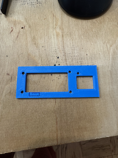`

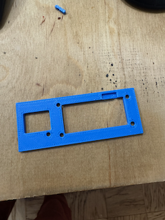`

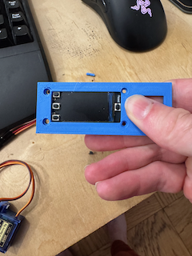`

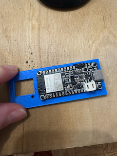`

Use a pair of tweezers (or similar) to remove the small section where the headers will fit
from the underside of the 3D print.

Attach all the bolts and nuts. Use the thread locker to make sure
they don't loosen. Also makes sure that subs can't just open it by shaking :-).

### Step 8: Wire and mount Optiga Trust M (Official Builds)

* Optiga Trust M Breakout
* STEMMA QT / Qwiic JST SH 4-Pin Cable (50mm)
* 3M VHB tape

Connect the Optiga Trust M breakout to the ESP32-S3 board using the 50mm STEMMA QT cable.
Cut a small piece of 3M VHB tape and affix the back of the breakout board securely to the inside wall of the enclosure, ensuring the board and cable stay completely clear of the sliding tray and servo arm.
The orientation doesn't matter but I personally arrange it so the silkscreen printed shackle points toward the tray.

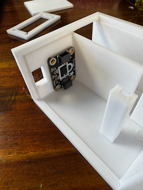`

### Step 9: Wire and mount code reader (Optional / Legacy Builds Only)

> [!NOTE]
> We now explicitly advise against using the QR code reader, and modern 3D enclosure models omit the slot for it. If you are building a modern lock using Web Serial or BLE setup, skip this step.

* Tiny code reader
* Stemma QT cable
* 1 bolt
* 1 nut
* 2 spacers from 3D print

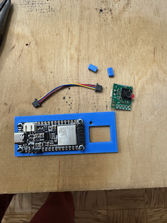`

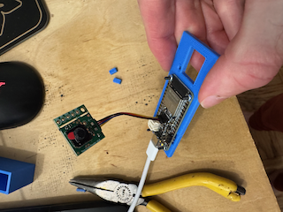`

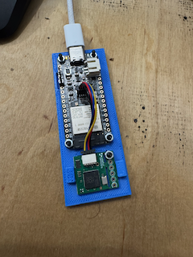`

Connect the tiny code reader with the stemma QT cable to the main board.

Mount the tiny code reader with the bolt + nut.

I use 2 "spacers" to secure the code reader in place because it only has the one
screw mount hole. I use a *tiny* amount of activator on the board and 2-part epoxy
the spacers above and below the reader. See pic.

### Step 10: Test and then make wire connections permanent

Plug it in and cycle the lock. When you're satisfied it's all working make the wire connections permanent with 2-part epoxy.

### Step 11: Mount servo to main body

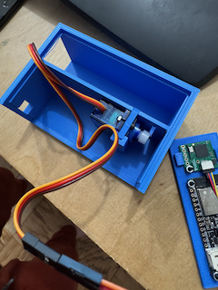`

### Step 12: Mount technical lid to main body

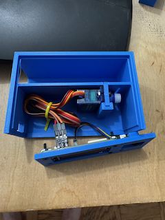`

I use a tiny cable tie to make this a little easier and a little more organized.

Use your 2-part epoxy to secure the front lid to the body.

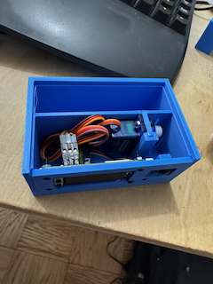`

### Step 13: Seal top

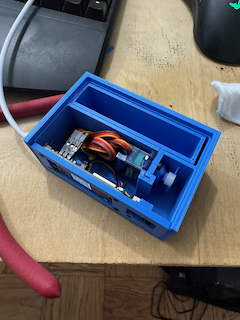`

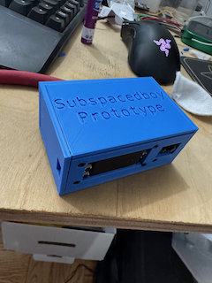`

I use 2-part epoxy on the left sill, the right sill, and across
the front where all the technical parts are mounted.
If you're using hot glue for temporary testing, be sure wherever you apply it doesn't interfere with the tray sliding in and out.

In order to get the best seal I recommend leaving a heavy weight on it while it cures.
I have a tupperware full of change for this. Give it an hour or two.

### Done!

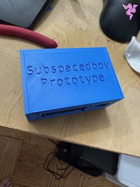`

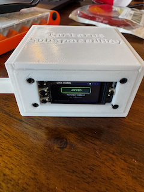`