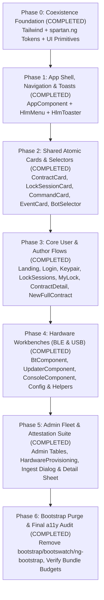

# Tartarus Frontend Migration Strategy: `bootstrap-ng` to `spartan.ng`

> [!IMPORTANT]
> **Audience**: Downstream engineering agents and developers executing the UI migration.
> **Companion Document**: Read [STYLEGUIDE.md](file:///Users/chris/Development/qrdisplay/tartarus/STYLEGUIDE.md) BEFORE modifying any template or stylesheet.
> **Core Rule**: Every phase in this document is designed to leave the application in a **compilable, testable, and functional state** (`npm run build && npm test`). Never attempt a "big bang" rewrite in a single turn.

---

## 1. Current State Inventory & Dependency Audit

### 1.1 Legacy Dependencies to Replace ([package.json](file:///Users/chris/Development/qrdisplay/tartarus/package.json))
- `@ng-bootstrap/ng-bootstrap` (`^21.0.0`) — Used in only **5 components**:
  1. [AppComponent](file:///Users/chris/Development/qrdisplay/tartarus/src/app/app.component.ts) (`NgbDropdown`, `NgbDropdownMenu`, `NgbDropdownToggle`, `NgbDropdownItem`)
  2. [ToastContainerComponent](file:///Users/chris/Development/qrdisplay/tartarus/src/app/toast-container/toast-container.component.ts) (`NgbToast`)
  3. [LockSessionsComponent](file:///Users/chris/Development/qrdisplay/tartarus/src/app/lock-sessions/lock-sessions.component.ts) (`NgbModal`)
  4. [ContractDetailComponent](file:///Users/chris/Development/qrdisplay/tartarus/src/app/contract-detail/contract-detail.component.ts), [LockUserContractDetailComponent](file:///Users/chris/Development/qrdisplay/tartarus/src/app/lock-user-contract-detail/lock-user-contract-detail.component.ts), & [BotSelectorComponent](file:///Users/chris/Development/qrdisplay/tartarus/src/app/bot-selector/bot-selector.component.ts) (`NgbTooltip`)
- `bootstrap` (`^5.3.3`) & `bootswatch` (`^5.3.3`, `spacelab` theme imported in [styles.scss](file:///Users/chris/Development/qrdisplay/tartarus/src/styles.scss#L3))
- `@popperjs/core` (`^2.11.8`) — Peer dependency of `ng-bootstrap`
- `ngx-spinner` (`^17.0.0`) — Unused (commented out in [app.component.html](file:///Users/chris/Development/qrdisplay/tartarus/src/app/app.component.html#L42))

### 1.2 Target Stack to Install
- **Tailwind CSS** (`tailwindcss`, `@tailwindcss/postcss`, `postcss`)
- **Spartan Core**: `@spartan-ng/brain` (`brn-*` headless accessible primitives built on `@angular/cdk`, which is already installed at `^22.2.2`) and `hlm-*` Helm UI primitives in `src/app/shared/ui/` (mapped to `@spartan-ng/ui-*` in `tsconfig.json`)
- **Toast Primitive**: `ngx-sonner` (`hlm-toaster`)
- **Iconography**: `@ng-icons/core` and `@ng-icons/lucide` (replacing inconsistent inline emojis and unstyled `<svg>` paths)
- **Class Utilities**: `clsx`, `tailwind-merge`, `class-variance-authority` (used by `spartan.ng` `hlm()` helper)

---

## 2. Migration Sequencing Overview

---

## 3. Detailed Phase-by-Phase Execution Plan

### Phase 0: Foundation, Coexistence & `spartan.ng` Primitives Setup (COMPLETED)
**Goal**: Install Tailwind CSS and `spartan.ng`, configure the design tokens from [STYLEGUIDE.md](file:///Users/chris/Development/qrdisplay/tartarus/STYLEGUIDE.md#L27-L103), and scaffold the `hlm-*` UI libraries while keeping Bootstrap temporarily active so existing pages do not break during incremental migration.

**Tasks**:
1. **Install Packages**:
   - Install `@spartan-ng/brain`, `class-variance-authority`, `clsx`, `tailwind-merge`, `ngx-sonner`, `@ng-icons/core`, `@ng-icons/lucide`, and Tailwind CSS.
   - Remove unused `ngx-spinner` from [package.json](file:///Users/chris/Development/qrdisplay/tartarus/package.json).
2. **Scaffold `spartan.ng` Helm (`hlm`) UI Primitives**:
   - Place the `spartan.ng` Helm directives in `src/app/shared/ui/` with tsconfig path mappings `@spartan-ng/ui-*` and `@spartan-ng/helm/*`:
     - `ui-utils` (`hlm()` helper combining `clsx` + `twMerge`)
     - `ui-button-helm` (`HlmButtonDirective` / `[hlmBtn]`)
     - `ui-badge-helm` (`HlmBadgeDirective` / `[hlmBadge]`)
     - `ui-card-helm` (`HlmCardDirective`, `HlmCardHeaderDirective`, `HlmCardTitleDirective`, `HlmCardDescriptionDirective`, `HlmCardContentDirective`, `HlmCardFooterDirective`)
     - `ui-input-helm` (`HlmInputDirective` / `[hlmInput]`) & `ui-label-helm` (`HlmLabelDirective` / `[hlmLabel]`)
     - `ui-switch-helm` (`HlmSwitchComponent` / `<hlm-switch>`)
     - `ui-alert-helm` (`HlmAlertDirective`, `HlmAlertTitleDirective`, `HlmAlertDescriptionDirective`, `HlmAlertIconDirective`)
     - `ui-dialog-helm` (`HlmDialogComponent`, `HlmDialogContentComponent`, `HlmDialogHeaderComponent`, `HlmDialogFooterComponent`, `HlmDialogTitleDirective`, `HlmDialogDescriptionDirective`)
     - `ui-sheet-helm` (`HlmSheetComponent`, `HlmSheetContentComponent`, `HlmSheetHeaderComponent`, `HlmSheetFooterComponent`, `HlmSheetTitleDirective`, `HlmSheetDescriptionDirective`)
     - `ui-menu-helm` (`HlmMenuComponent`, `HlmMenuItemDirective`, `HlmMenuSeparatorComponent`, `HlmMenuLabelComponent`, `HlmMenuGroupComponent`)
     - `ui-tooltip-helm` (`HlmTooltipComponent`, `HlmTooltipTriggerDirective`)
     - `ui-tabs-helm` (`HlmTabsComponent`, `HlmTabsListComponent`, `HlmTabsTriggerDirective`, `HlmTabsContentDirective`)
     - `ui-table-helm` (`HlmTableDirective`, `HlmTrowDirective`, `HlmThDirective`, `HlmTdDirective`, `HlmCaptionDirective`)
     - `ui-progress-helm` (`HlmProgressDirective`, `HlmProgressIndicatorDirective`) & `ui-spinner-helm` (`HlmSpinnerComponent`)
     - `ui-separator-helm` (`HlmSeparatorDirective`)
     - `ui-sonner-helm` (`HlmToasterComponent` / `<hlm-toaster>`)
3. **Configure [styles.scss](file:///Users/chris/Development/qrdisplay/tartarus/src/styles.scss) & [index.html](file:///Users/chris/Development/qrdisplay/tartarus/src/index.html) for Coexistence**:
   - Declare `<meta name="color-scheme" content="light dark">` in `src/index.html`.
   - Add Tailwind layers and the `:root` / `.dark` CSS variables defined in [STYLEGUIDE.md Section 2.1](file:///Users/chris/Development/qrdisplay/tartarus/STYLEGUIDE.md#L27-L103), plus forced-colors accessibility fallbacks and subtree `color-scheme` rules for `.log-terminal` / `.terminal-screen` and `.qr-quiet-zone`.
   - Scope legacy `.btn` and `.row` spacing hacks so they do not pollute `[hlmBtn]` elements.
4. **Update [angular.json](file:///Users/chris/Development/qrdisplay/tartarus/angular.json) Style Budgets During Coexistence**:
   - Ensure `initial` budget accommodates both Bootstrap and Tailwind during Phases 0–5; Bootstrap is purged in Phase 6.

**Acceptance Criteria**:
- `npm run build` and `npm test` pass with zero errors.
- `hlmBtn`, `hlmCard`, and `hlmBadge` render with the new Cryptographic Indigo & Slate tokens.

---

### Phase 1: App Shell, Navigation & Toast System (COMPLETED)
**Goal**: Migrate the global shell ([AppComponent](file:///Users/chris/Development/qrdisplay/tartarus/src/app/app.component.ts)) and notification infrastructure ([ToastContainerComponent](file:///Users/chris/Development/qrdisplay/tartarus/src/app/toast-container/toast-container.component.ts), [ToastService](file:///Users/chris/Development/qrdisplay/tartarus/src/app/toast.service.ts)), eliminating `NgbDropdown` and `NgbToast`.

**Files to Modify**:
- [src/app/app.component.ts](file:///Users/chris/Development/qrdisplay/tartarus/src/app/app.component.ts) & [src/app/app.component.html](file:///Users/chris/Development/qrdisplay/tartarus/src/app/app.component.html) & [src/app/app.component.scss](file:///Users/chris/Development/qrdisplay/tartarus/src/app/app.component.scss)
- [src/app/toast.service.ts](file:///Users/chris/Development/qrdisplay/tartarus/src/app/toast.service.ts)
- [src/app/toast-container/toast-container.component.ts](file:///Users/chris/Development/qrdisplay/tartarus/src/app/toast-container/toast-container.component.ts) & [src/app/toast-container/toast-container.component.html](file:///Users/chris/Development/qrdisplay/tartarus/src/app/toast-container/toast-container.component.html)

**Tasks for Downstream Agent**:
1. **Replace `NgbDropdown` in `AppComponent`**:
   - Build a modern sticky header (`<header class="sticky top-0 z-40 w-full border-b border-border bg-background/95 backdrop-blur">`).
   - Display brand logo (`Tartarus`) with a `lucideShield` or `lucideLock` icon on the left.
   - Surface primary navigation links on desktop (`Home`, conditional `Lock Sessions` when `hasAuthorSession`, conditional `My Lock` when `hasLockSessions`) and a `Hardware & Tools` dropdown using `brnMenuTriggerFor` + `hlmMenu` (`Bluetooth Setup (BLE)`, `Firmware Flasher (USB)`, `Serial Console (USB)`, `Lock Configuration Data`).
   - Fix the invalid `<button ngbDropdownItem><a routerLink="...">` nesting by using `<a hlmMenuItem routerLink="...">` directly.
   - Include active session indicators (e.g. `Keyholder` / `Wearer` badge + Logout action in a session menu).
2. **Replace `NgbToast` with `HlmToaster` (`ngx-sonner`)**:
   - Render `<hlm-toaster />` inside `app.component.html` (or inside `ToastContainerComponent` for backward compatibility with existing specs).
   - Refactor `ToastService.showInfo()`, `showSuccess()`, and `showError()` to trigger `ngx-sonner` `toast.info()`, `toast.success()`, and `toast.error()` while preserving the `toasts` array if any unit test inspects it.

**Acceptance Criteria**:
- Zero `NgbDropdown*` or `NgbToast` imports remain in the codebase.
- All links in `AppComponent` are keyboard-navigable (`Tab`, `ArrowDown`, `Enter`, `Escape`) with no `<button><a>` HTML nesting violations.

---

### Phase 2: Shared Atomic Cards & Selector Components (COMPLETED)
**Goal**: Migrate all reusable child components used across multiple views so that parent pages in Phases 3–5 automatically inherit clean `spartan.ng` cards, badges, and tooltips.

**Files to Modify**:
- [src/app/contract-card/contract-card.component.html](file:///Users/chris/Development/qrdisplay/tartarus/src/app/contract-card/contract-card.component.html) & `.ts`
- [src/app/lock-session-card/lock-session-card.component.html](file:///Users/chris/Development/qrdisplay/tartarus/src/app/lock-session-card/lock-session-card.component.html) & `.ts`
- [src/app/command-card/command-card.component.html](file:///Users/chris/Development/qrdisplay/tartarus/src/app/command-card/command-card.component.html) & `.ts`
- [src/app/event-card/event-card.component.html](file:///Users/chris/Development/qrdisplay/tartarus/src/app/event-card/event-card.component.html) & `.ts`
- [src/app/bot-selector/bot-selector.component.html](file:///Users/chris/Development/qrdisplay/tartarus/src/app/bot-selector/bot-selector.component.html) & [bot-selector.component.ts](file:///Users/chris/Development/qrdisplay/tartarus/src/app/bot-selector/bot-selector.component.ts)

**Tasks for Downstream Agent**:
1. **Unify `ContractCardComponent` & `CommandCardComponent`**:
   - Eliminate the 6-branch `@switch` that repeats `.card.bg-success.text-white` / `.card.bg-primary.text-white`.
   - Use a single `<section hlmCard>` with a left status accent border (`border-l-4`) and a semantic `` for the state (`CONFIRMED`, `ACCEPTED`, `CREATED`, `PENDING`, `RELEASED`, `REJECTED`).
   - Remove the hardcoded `style="max-width: 20rem;"` so cards fill their parent CSS Grid cell cleanly.
   - In `CommandCardComponent`, style `Show QR Code`, `Send via Serial`, and `Manually Acknowledge` using `hlmBtn` (`variant="outline"`, `variant="secondary"`, `variant="warning"`).
2. **Migrate `LockSessionCardComponent` & `EventCardComponent`**:
   - Use `hlmCard`, `hlmBadge`, and `font-mono` token pills with a one-click copy button (`lucideCopy` / `lucideCheck`).
3. **Migrate `BotSelectorComponent` (Eliminating `NgbTooltip`)**:
   - Replace `NgbTooltip` with `HlmTooltipTriggerDirective` (`[hlmTooltip]`).
   - Convert the `` into an accessible `<button type="button" hlmBadge variant="secondary" class="font-mono cursor-pointer">` so keyboard users can focus and copy bot public keys.
   - Replace the search `.input-group` and sort `.btn-group` with `hlmInput` and `hlmBtn` toggle buttons.

**Acceptance Criteria**:
- Zero full-bleed colored cards (`bg-success text-white`, `bg-primary text-white`) remain.
- `BotSelectorComponent` has zero `NgbTooltip` imports and passes keyboard accessibility checks.

---

### Phase 3: Core User & Author Flows (Contracts, Sessions & Keys) (COMPLETED)
**Goal**: Migrate all end-user (Wearer) and Contract Author (Keyholder) routes, fixing the `col-lg-4` single-column layout anti-pattern and removing all remaining `NgbModal` and `NgbTooltip` usages.

**Files to Modify**:
- [src/app/landing-page/landing-page.component.html](file:///Users/chris/Development/qrdisplay/tartarus/src/app/landing-page/landing-page.component.html)
- [src/app/new-keypair/new-keypair.component.html](file:///Users/chris/Development/qrdisplay/tartarus/src/app/new-keypair/new-keypair.component.html)
- [src/app/login/login.component.html](file:///Users/chris/Development/qrdisplay/tartarus/src/app/login/login.component.html)
- [src/app/lock-start/lock-start.component.html](file:///Users/chris/Development/qrdisplay/tartarus/src/app/lock-start/lock-start.component.html)
- [src/app/lock-sessions/lock-sessions.component.html](file:///Users/chris/Development/qrdisplay/tartarus/src/app/lock-sessions/lock-sessions.component.html) & [lock-sessions.component.ts](file:///Users/chris/Development/qrdisplay/tartarus/src/app/lock-sessions/lock-sessions.component.ts)
- [src/app/lock-session-detail/lock-session-detail.component.html](file:///Users/chris/Development/qrdisplay/tartarus/src/app/lock-session-detail/lock-session-detail.component.html)
- [src/app/new-full-contract/new-full-contract.component.html](file:///Users/chris/Development/qrdisplay/tartarus/src/app/new-full-contract/new-full-contract.component.html)
- [src/app/contract-detail/contract-detail.component.html](file:///Users/chris/Development/qrdisplay/tartarus/src/app/contract-detail/contract-detail.component.html) & [contract-detail.component.ts](file:///Users/chris/Development/qrdisplay/tartarus/src/app/contract-detail/contract-detail.component.ts)
- [src/app/my-lock/my-lock.component.html](file:///Users/chris/Development/qrdisplay/tartarus/src/app/my-lock/my-lock.component.html)
- [src/app/lock-user-contract-detail/lock-user-contract-detail.component.html](file:///Users/chris/Development/qrdisplay/tartarus/src/app/lock-user-contract-detail/lock-user-contract-detail.component.html) & [lock-user-contract-detail.component.ts](file:///Users/chris/Development/qrdisplay/tartarus/src/app/lock-user-contract-detail/lock-user-contract-detail.component.ts)

**Tasks for Downstream Agent**:
1. **Redesign `LandingPageComponent` into a 2-Column Role Split**:
   - Replace the two stacked `

` blocks with a balanced 2-column responsive grid (`grid grid-cols-1 lg:grid-cols-2 gap-6 max-w-5xl mx-auto py-6`):
     - **Left Card (`hlmCard`)**: *Keyholder / Contract Author* ("Write contracts and hold keys"), featuring either a 3-step visual onboarding timeline (`Step 1: Generate Key`, `Step 2: Authenticate`, `Step 3: Open Session Link`) or the active dashboard (`View Lock Sessions` CTA + active `app-contract-card` grid).
     - **Right Card (`hlmCard`)**: *Lock Wearer / Holder* ("Have my keys held"), featuring QR onboarding instructions or `My Lock` CTA + pending contract review cards.
2. **Redesign `LoginComponent` & `NewKeypairComponent` (Archetype 1: Centered Card)**:
   - Center in `max-w-xl mx-auto py-8`.
   - Replace raw `<input type="file">` in `LoginComponent` with an accessible QR image dropzone card.
   - Frame the generated QR code `<canvas>` in `NewKeypairComponent` inside a `.qr-quiet-zone` container with a prominent warning `hlmAlert` about backing up the key.
3. **Replace `NgbModal` in `LockSessionsComponent`**:
   - Convert `#deleteConfirmModal` and `NgbModal.open()` into `HlmDialog` / `HlmAlertDialog`.
   - Render the lock sessions in a responsive grid (`grid grid-cols-1 sm:grid-cols-2 lg:grid-cols-3 xl:grid-cols-4 gap-4`).
4. **Upgrade `ContractDetailComponent`, `LockUserContractDetailComponent`, `MyLockComponent`, & `LockSessionDetailComponent`**:
   - Replace `NgbTooltip` on attached bot public keys with `HlmTooltipTriggerDirective` and `<button type="button" hlmBadge>` (matching `BotSelectorComponent`).
   - Replace the raw inline `<svg width="35" height="35">` lock status icons with a dedicated **Physical Lock Status Hero Banner** inside `hlmCard`:
     - Shows `🔒 Locked` (`--status-locked`) or `🔓 Unlocked` (`--status-unlocked`) with `lucideLock` / `lucideLockOpen`, last update relative timestamp (`dateAgo`), and a high-priority `hlmAlert variant="destructive"` if `emergencyUnlocked` is true.
   - Group Lock/Unlock/Release controls clearly: `Lock` and `Unlock` side-by-side (`grid grid-cols-2 gap-3`), with `Release Contract` separated below by an `hlmSeparator` and styled as a distinct cautionary action.
   - Move "Advanced Stuff / Bump Command Counter" into a collapsible disclosure (`
`) or muted danger-zone footer card so users don't click it by accident.
5. **Migrate `NewFullContractComponent`**:
   - Replace `.form-check.form-switch` with `<hlm-switch>` + `hlmLabel` for `isTempUnlockAllowed` and `isEmergencyUnlockAllowed`.
   - Frame the `#hiddenDiv` QR canvas inside a clean `hlmCard` with a `.qr-quiet-zone` wrapper.

**Acceptance Criteria**:
- **Zero `@ng-bootstrap/ng-bootstrap` imports remain anywhere in `src/app/`!**
- All author and wearer pages use proper responsive grid widths instead of narrow left-hugging `col-lg-4` columns.

---

### Phase 4: Hardware Workbenches (`/bt`, `/updater`, `/console`, `/configuration`, Helpers) (COMPLETED)
**Goal**: Elevate the Web Bluetooth, Web Serial, and QR configuration tools into a cohesive "Hardware Engineering Workbench" aesthetic using `spartan.ng` cards, tabs, radio cards, progress bars, and dark terminal surfaces.

**Files to Modify**:
- [src/app/bt/bt.component.html](file:///Users/chris/Development/qrdisplay/tartarus/src/app/bt/bt.component.html) & [bt.component.scss](file:///Users/chris/Development/qrdisplay/tartarus/src/app/bt/bt.component.scss)
- [src/app/updater/updater.component.html](file:///Users/chris/Development/qrdisplay/tartarus/src/app/updater/updater.component.html) & [updater.component.scss](file:///Users/chris/Development/qrdisplay/tartarus/src/app/updater/updater.component.scss)
- [src/app/console/console.component.html](file:///Users/chris/Development/qrdisplay/tartarus/src/app/console/console.component.html) & [console.component.scss](file:///Users/chris/Development/qrdisplay/tartarus/src/app/console/console.component.scss)
- [src/app/coordinator-configuration/coordinator-configuration.component.html](file:///Users/chris/Development/qrdisplay/tartarus/src/app/coordinator-configuration/coordinator-configuration.component.html)
- [src/app/wifi-helper/wifi-helper.component.html](file:///Users/chris/Development/qrdisplay/tartarus/src/app/wifi-helper/wifi-helper.component.html)
- [src/app/key-helper/key-helper.component.html](file:///Users/chris/Development/qrdisplay/tartarus/src/app/key-helper/key-helper.component.html)

**Tasks for Downstream Agent**:
1. **Bluetooth Manager (`BtComponent`)**:
   - Retain the effective 12-column workbench split (`lg:col-span-7` controls + `lg:col-span-5` sticky activity log).
   - Convert cards 1–6 to `hlmCard` with numbered step badges (`1`, `2`, `3`...) in `hlmCardHeader` instead of solid black `.bg-dark.text-white` headers.
   - Style the 6-digit BLE PIN input (`#pin`) with `hlmInput` + `font-mono text-3xl tracking-[0.4em] text-center tabular-nums`.
   - Convert the Event Queue Inspector table (Card 6) to `hlmTable` and add `aria-live="polite"` to the connection status badges.
2. **Firmware Flasher (`UpdaterComponent`)**:
   - Convert the Release Track selector (Arbitrary vs. Signed) into selectable choice cards.
   - Convert the "Arbitrary Binary Source" toggle (Server Manifest vs. Local Custom `.bin` Upload) into `HlmTabs`.
   - Replace the Bootstrap `.progress-bar` with `HlmProgress` and highlight the Permanent Secure Boot eFuse warning using `hlmAlert variant="destructive"`.
3. **Serial Console (`ConsoleComponent`)**:
   - Style the terminal toolbar and STDIN footer using `--terminal-bg` (`#090D16`), styled select controls for baud rate and line endings (`CRLF`, `LF`, `CR`), and `hlmSwitch` for `Auto-scroll` and `Echo Commands`.
4. **Configuration & Helper Tools (`CoordinatorConfigurationComponent`, `WifiHelperComponent`, `KeyHelperComponent`)**:
   - Fix the stacked `col-lg-4` layout in `CoordinatorConfigurationComponent` by placing "Coordinator Backend Selection" and "Lock Configuration QR Generator" side-by-side in a 2-column grid (`max-w-5xl mx-auto`).
   - Fix the copy-paste placeholder bug in [wifi-helper.component.html](file:///Users/chris/Development/qrdisplay/tartarus/src/app/wifi-helper/wifi-helper.component.html#L24) where the Wi-Fi password input has `placeholder="WS URI"` and `type="text"`!

**Acceptance Criteria**:
- All hardware tools share an identical header bar, status badge system, and sticky terminal log component style.
- Existing unit tests in `bt.component.spec.ts` and `updater.component.spec.ts` pass.

---

### Phase 5: Admin Fleet, Provisioning & Attestation Suite (`/admin/*`) (COMPLETED)
**Goal**: Migrate all administrative tables, filters, and the two custom hardware modals (`ProvisioningIngestModalComponent` and `HardwareUnitDetailModalComponent`) to accessible `spartan.ng` tables, dialogs, and side sheets.

**Files to Modify**:
- [src/app/admin/admin-landing-page/admin-landing-page.component.html](file:///Users/chris/Development/qrdisplay/tartarus/src/app/admin/admin-landing-page/admin-landing-page.component.html)
- [src/app/admin/admin-login/admin-login.component.html](file:///Users/chris/Development/qrdisplay/tartarus/src/app/admin/admin-login/admin-login.component.html)
- [src/app/admin/admin-contracts/admin-contracts.component.html](file:///Users/chris/Development/qrdisplay/tartarus/src/app/admin/admin-contracts/admin-contracts.component.html)
- [src/app/admin/admin-contract-detail/admin-contract-detail.component.html](file:///Users/chris/Development/qrdisplay/tartarus/src/app/admin/admin-contract-detail/admin-contract-detail.component.html)
- [src/app/admin/admin-lock-sessions/admin-lock-sessions.component.html](file:///Users/chris/Development/qrdisplay/tartarus/src/app/admin/admin-lock-sessions/admin-lock-sessions.component.html)
- [src/app/admin/admin-lock-session-detail/admin-lock-session-detail.component.html](file:///Users/chris/Development/qrdisplay/tartarus/src/app/admin/admin-lock-session-detail/admin-lock-session-detail.component.html)
- [src/app/admin/admin-add-firmware/admin-add-firmware.component.html](file:///Users/chris/Development/qrdisplay/tartarus/src/app/admin/admin-add-firmware/admin-add-firmware.component.html)
- [src/app/admin/hardware/hardware-provisioning.component.html](file:///Users/chris/Development/qrdisplay/tartarus/src/app/admin/hardware/hardware-provisioning.component.html)
- [src/app/admin/hardware/provisioning-ingest-modal.component.html](file:///Users/chris/Development/qrdisplay/tartarus/src/app/admin/hardware/provisioning-ingest-modal.component.html)
- [src/app/admin/hardware/hardware-unit-detail-modal.component.html](file:///Users/chris/Development/qrdisplay/tartarus/src/app/admin/hardware/hardware-unit-detail-modal.component.html)

**Tasks for Downstream Agent**:
1. **Admin Hub & Firmware Upload (`AdminLandingPageComponent`, `AdminAddFirmwareComponent`)**:
   - Turn `AdminLandingPageComponent` from a bare 4-item `.list-group` into a 4-card dashboard hub (`Live Contracts`, `Lock Sessions`, `Hardware Fleet & Provisioning`, `Firmware Repository`) with icons and descriptions.
   - Style `AdminAddFirmwareComponent` (currently 4 lines of unstyled HTML!) inside a centered `hlmCard` with file upload dropzone and `hlmBtn`.
2. **Admin Tables (`AdminContractsComponent`, `AdminLockSessionsComponent`, `HardwareProvisioningComponent`)**:
   - Migrate tables to `hlmTable` with sticky headers, monospace ID/token columns, and accessible filter pills.
   - In `HardwareProvisioningComponent`, make the 4 summary metric cards (`Total Provisioned`, `Production (HARD)`, `Development (SOFT)`, `Revoked Units`) keyboard-accessible `<button type="button">` cards with `aria-pressed` state reflecting `selectedModeFilter()`.
3. **Convert Custom Hardware Overlays to `HlmDialog` and `HlmSheet`**:
   - Convert `ProvisioningIngestModalComponent` from `
` to `HlmDialog` with proper focus trapping and `Escape` dismissal.
   - Convert `HardwareUnitDetailModalComponent` into a wide right-hand `HlmSheet` drawer (`side="right" class="w-full sm:max-w-3xl overflow-y-auto"`) or `HlmDialog` so admins can inspect X.509 certificates, `0xE0F0` signatures, eFuse posture badges, and challenge-response logs with full keyboard accessibility.

**Acceptance Criteria**:
- Custom `.modal.d-block` overlays are replaced with CDK/Spartan accessible dialogs/sheets (or retain compatible host selectors if tested by `hardware-provisioning.component.spec.ts`).
- All existing tests in `hardware-provisioning.component.spec.ts` pass.

---

### Phase 6: Bootstrap Purge, Cleanup & Verification (COMPLETED)
**Goal**: Remove `bootstrap`, `bootswatch`, `@ng-bootstrap/ng-bootstrap`, and `@popperjs/core` completely, clean up legacy CSS classes, and verify bundle budgets and unit tests.

**Tasks for Downstream Agent**:
1. **Remove Legacy Packages from [package.json](file:///Users/chris/Development/qrdisplay/tartarus/package.json)**:
   - Uninstall `@ng-bootstrap/ng-bootstrap`, `@popperjs/core`, `bootstrap`, `bootswatch`, and `ngx-spinner`.
2. **Clean Up [src/styles.scss](file:///Users/chris/Development/qrdisplay/tartarus/src/styles.scss)**:
   - Remove `@import '../node_modules/bootswatch/dist/spacelab/bootstrap.min.css';`.
   - Remove legacy `.navbar`, `.dropdown-menu`, `.list-group-item`, `.btn`, and `.row` workarounds.
3. **Audit Templates for Orphaned Bootstrap Classes**:
   - Search all `.html` and `.ts` files for leftover `col-lg-`, `bs-component`, `btn-`, `bg-body-tertiary`, `form-control`, `list-group`, `ngb*`, and `data-bs-dismiss`.
   - Notice and remove dead `data-bs-dismiss="alert"` attributes (such as in `login.component.html`, `admin-login.component.html`, `lock-start.component.html`, and `coordinator-configuration.component.html`, which never worked without Bootstrap's JS bundle anyway!).
4. **Verify Build, Bundle Budgets & Test Suite**:
   - Run `npm run build` and verify that removing `bootstrap.min.css` reduces the CSS bundle well within the [angular.json](file:///Users/chris/Development/qrdisplay/tartarus/angular.json#L47-L57) production budgets (`1.1MB` initial, `4kB` component style).
   - Run `npm test` (Vitest) and ensure 100% of unit tests pass.
